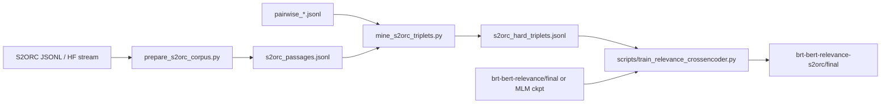

# BRT-BERT × S2ORC — Training Ideas Review

**Date:** 2026-08-07

**Scope:** Improve BRT-BERT relevance accuracy using the Semantic Scholar Open Research Corpus (S2ORC).

---

## Current Model Stack

| Stage | Checkpoint | Architecture | Eval F1 (held-out) |
|-------|------------|--------------|-------------------|
| Base | `allenai/scibert_scivocab_uncased` | SciBERT | — |
| Domain MLM | `brt-bert-irr-buddy-mlm/checkpoint-*` | `BertForMaskedLM` | — |
| Relevance CE | `brt-bert-relevance/final` | CrossEncoder (BCE) | **0.953** |
| IRR variant | `brt-bert-irr-buddy-mlm/relevance/final` | CrossEncoder (BCE) | 0.937 |

**Training data today:** ~94k `(query, positive, negative)` triplets from three arch1 JSONL workers (`pairwise_local`, `pairwise_longcat`, `pairwise_llm_q1`). Negatives are mostly *easy* — random or LLM-picked irrelevant papers — not structurally similar hard negatives from the same scientific neighborhood.

**Inference contract (SystS Stage 2 / 8):**

- Input pair: `(question_to_claim(query), title + abstract + optional fulltext[:8000])`
- Output: sigmoid relevance in `[0, 1]`, threshold ~0.236–0.368 depending on checkpoint
- Max sequence length: **384 tokens**

**Gap S2ORC fills:** 8–14M English papers with title, abstract, and often full body text — ideal for domain adaptation *and* for mining *hard* negatives (same venue, overlapping vocabulary, wrong paper).

---

## Training Ideas (Ranked)

### Idea 1 — S2ORC continued MLM on SciBERT *(domain adaptation)*

Continue masked-language-model pretraining on S2ORC passage text, then fine-tune the cross-encoder as today.

| Pros | Cons |
|------|------|
| Improves scientific vocabulary & syntax in embeddings | Expensive (GPU-days on full corpus) |
| Complements SciBERT without new labels | Does not directly optimize relevance ranking |
| Matches existing `brt-bert-irr-buddy-mlm` architecture | Diminishing returns if MLM corpus overlaps SciBERT training |

**When to pick:** You have GPU budget and want a better backbone before any labeled fine-tuning.

---

### Idea 2 — Section-aware / structured MLM *(S2ORC body text)*

MLM with segment embeddings or explicit markers for `[TITLE]`, `[ABSTRACT]`, `[INTRO]`, `[METHODS]` sections parsed from S2ORC `body_text` / `sections`.

| Pros | Cons |
|------|------|
| Teaches layout of scientific documents | Parsing quality varies (GROBID noise) |
| Better representations for long-document screening | Still not relevance-specific |
| Useful if Stage 7 full-text scoring grows | More preprocessing complexity |

**When to pick:** Full-text relevance (not just abstract) is a near-term product goal.

---

### Idea 3 — Synthetic query–document triplets from S2ORC metadata *(data scaling)*

For each S2ORC paper, synthesize:

- **Query:** title → research question (template or small LLM)
- **Positive:** `title + abstract` (matches SystS `_paper_text`)
- **Negative:** random or BM25-nearmiss paper

| Pros | Cons |
|------|------|
| Scales to millions of cheap labels | Synthetic queries ≠ real user questions |
| Directly feeds existing `train_relevance_crossencoder.py` | Risk of title–abstract leakage (too easy) |
| Fast to implement | Needs filtering to avoid trivial positives |

**When to pick:** You need 10× more training rows quickly and will filter aggressively.

---

### Idea 4 — S2ORC hard-negative triplet mining *(recommended)*

Keep existing gold triplets; **augment** with negatives mined from S2ORC:

1. Index S2ORC passages (title + abstract).
2. For each labeled `(query, positive)`, find S2ORC papers whose **title token Jaccard** is high with the positive but **low with the query**.
3. Replace easy negatives with these *hard* negatives in ~30–50% of augmented rows.
4. Fine-tune cross-encoder from `brt-bert-relevance/final` (warm-start) or MLM checkpoint.

| Pros | Cons |
|------|------|
| Targets the actual failure mode (similar but wrong paper) | Requires one-time S2ORC index build |
| Builds on proven 0.953 F1 checkpoint | Mining heuristics need tuning per domain |
| Plugs into existing trainer & SystS inference | Still needs some gold query labels |

**When to pick:** **Default choice** — best accuracy lift per GPU hour.

---

### Idea 5 — Multi-task MLM + relevance (joint training)

Single training loop: MLM loss on S2ORC chunks + BCE on labeled pairs (alternating batches).

| Pros | Cons |
|------|------|
| One pass over data | Hard to balance losses; CE head not active during MLM |
| Theoretically elegant | Engineering complexity; unstable without careful tuning |

**When to pick:** Research experiment, not first production iteration.

---

### Idea 6 — Distilled dense retriever (DR-BRT-BERT) for recall, CE for precision

Use S2ORC to train `scripts/train_dr_brt_bert.py` bi-encoder with in-batch negatives sampled from S2ORC; keep cross-encoder for final scoring.

| Pros | Cons |
|------|------|
| Faster corpus pre-filter at scale | Two models to maintain |
| S2ORC ideal for contrastive retrieval | Stage 2 today expects cross-encoder only |

**When to pick:** Corpus sizes exceed what a cross-encoder can rerank in reasonable time.

---

## Recommendation: **Idea 4 — S2ORC Hard-Negative Triplet Mining**

**Why this wins for SystS:**

1. **Directly attacks recall errors** — confusable papers in the same subfield are what systematic reviews lose at screening.
2. **Minimal inference change** — same CrossEncoder, same `question_to_claim`, same 384-token contract.
3. **Warm-start from 0.953 F1** — fine-tune 1–3 epochs on augmented data instead of training from scratch.
4. **Composes with Idea 1** — run MLM first if you later want a fresher backbone; mining pipeline stays the same.

### Proposed pipeline



### Suggested hyperparameters (fine-tune)

| Parameter | Value | Rationale |
|-----------|-------|-----------|
| `--checkpoint` | `brt-bert-relevance/final` | Warm-start best CE |
| `--train` | gold JSONLs + `s2orc_hard_triplets.jsonl` | Mix real + hard negatives |
| `--epochs` | 2 | Avoid catastrophic forgetting |
| `--lr` | `1e-5` | Lower than scratch (`2e-5`) |
| `--max-length` | 384 | Match production |
| `--batch-size` | 16 (CUDA) / 8 (MPS) | Fits 768-d SciBERT |

### Success metrics

Track on a **query-held-out** eval split (never split by pair — split by query, as DR-BRT-BERT does):

- `relevance_f1`, `relevance_recall` (recall matters most for screening)
- **Hard-negative bucket F1** — eval pairs where BM25@10 contains the positive but not in top-1
- Stage 8 κ vs LLM rater on a frozen 200-paper benchmark

---

## Scripts in This Folder

| File | Purpose |
|------|---------|
| `s2orc_io.py` | Parse legacy S2ORC JSON, HF records, local JSONL → normalized passages |
| `prepare_s2orc_corpus.py` | Stream corpus → `s2orc_passages.jsonl` |
| `mine_s2orc_triplets.py` | Build hard-negative triplets from passages + optional gold JSONL |
| `train_s2orc_mlm.py` | *(Idea 1)* Continue MLM on prepared passages |

### Quick start (Idea 4)

```bash
# 1. Prepare passages (local S2ORC JSONL or HF stream)
python brt-bert/prepare_s2orc_corpus.py \
  --input /data/s2orc/s2orc.jsonl.gz \
  --output /data/s2orc/s2orc_passages.jsonl \
  --limit 500000

# 2. Mine hard negatives + merge with gold labels
python brt-bert/mine_s2orc_triplets.py \
  --corpus /data/s2orc/s2orc_passages.jsonl \
  --gold /Volumes/Docker/arch1/pairwise_local.jsonl \
         /Volumes/Docker/arch1/pairwise_longcat.jsonl \
  --output /data/s2orc/s2orc_hard_triplets.jsonl \
  --hard-ratio 0.5

# 3. Fine-tune cross-encoder (existing repo script)
python scripts/train_relevance_crossencoder.py \
  --checkpoint brt-bert-relevance/final \
  --output brt-bert-relevance-s2orc \
  --train /Volumes/Docker/arch1/pairwise_local.jsonl \
          /Volumes/Docker/arch1/pairwise_longcat.jsonl \
          /data/s2orc/s2orc_hard_triplets.jsonl \
  --epochs 2 --lr 1e-5
```

### Optional: Idea 1 MLM before step 3

```bash
python brt-bert/train_s2orc_mlm.py \
  --corpus /data/s2orc/s2orc_passages.jsonl \
  --output brt-bert-s2orc-mlm \
  --epochs 1 --max-steps 100000
```

Then point `--checkpoint` at the MLM output in step 3.

---

## Data Sources

| Source | Access | Notes |
|--------|--------|-------|
| Legacy S2ORC JSONL | Local dump / `s2orc-doc2json` | Use `s2orc_io.load_record()` |
| HuggingFace `AlgorithmicResearchGroup/s2orc_full` | `datasets` streaming | Parquet, 14.5M papers |
| Semantic Scholar Datasets API | API key | Official successor to static dumps |

---

## Risks & Mitigations

| Risk | Mitigation |
|------|------------|
| Catastrophic forgetting on gold queries | Mix ≥50% original gold triplets; low LR; 2 epochs max |
| Title–abstract leakage in synthetics | Require hard negative Jaccard ≥ 0.25 with positive title |
| Eval query leakage | Split by `query` hash, not by row |
| 384-token truncation drops methods | Keep title+abstract first; matches production `_paper_text` |

---

## Next Steps

1. Run `prepare_s2orc_corpus.py` on a 500k-paper shard; verify passage stats.
2. Mine 50k–200k hard triplets; inspect 20 random rows manually.
3. Fine-tune 2 epochs; compare F1/recall vs `brt-bert-relevance/final` on query-held-out eval.
4. If recall ↑ but precision ↓, raise decision threshold via new `final_metrics.json`.
5. *(Optional)* Run MLM stage if CE gains plateau.
